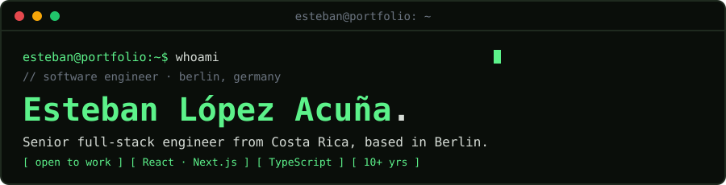

<p align="center">
  
</p>

<p align="center">
  <a href="https://estlopacu.github.io/"><b>portfolio</b></a> ·
  <a href="https://www.linkedin.com/in/estlopacu/"><b>linkedin</b></a> ·
  <a href="mailto:estlopacu@gmail.com"><b>email</b></a>
</p>

```console
esteban@portfolio:~$ cat about.md
```

Senior full-stack engineer, originally from Costa Rica and based in Berlin. Over the last decade I've delivered high-impact digital products across startups and scale-ups. I care about product quality, team collaboration and continuous improvement. Currently **open to new opportunities**.

```console
esteban@portfolio:~$ cat skills.yaml
```

```yaml
core_stack:  [TypeScript, React / Next.js, Node.js, Vue.js / Nuxt]
frontend:    [React Native, TanStack Query, React Router, Pinia, Tailwind, HTML, CSS]
cms:         [Sanity, Webflow]
infra_cloud: [AWS, Docker]
testing:     [Playwright, Cypress, E2E]
databases:   [PostgreSQL, MySQL]
```

<p>
  
</p>

```console
esteban@portfolio:~$ git log --author=esteban --oneline
```

```text
855bf67 (HEAD -> main) Senior Full Stack Engineer @ Payrails, Berlin          Jan 2026 – Aug 2026
        Built & launched a new company-website CMS (Next.js + Sanity); improved SEO
        and engagement; maintained the legacy Webflow site.

e74646d Senior Full Stack Engineer @ Freelance, Berlin                        Dec 2024 – Dec 2025
        Frontend and backend work for clients; mentored developers on projects
        in Costa Rica.

3d11293 Senior Full Stack Engineer @ Root Global, Berlin                      Jul 2024 – Nov 2024
        Contributed to the launch of the new web app; led a new tracking system
        enabling scalability and user-behavior insights.

9b67c39 Senior Full Stack Engineer @ GetYourGuide, Berlin                     May 2018 – Jun 2024
        A/B tests lifting conversion ~4%; company-wide E2E test migration to a
        Dockerized service; internal TS tracking package adopted across teams.
```

```console
esteban@portfolio:~$ ls work/
```

- 📦 [**indicadores-economicos-bccr**](https://www.npmjs.com/package/indicadores-economicos-bccr) — npm package converting USD ↔ CRC with live exchange rates from the Banco Central de Costa Rica SOAP service. `Node.js` `npm` `axios` `SOAP`
- 🧭 [**graphql-costa-rica-locations**](https://github.com/Estlopacu/graphql-costa-rica-locations) — GraphQL API for Costa Rica's provincia → cantón → distrito data, with type-checked resolvers. `Apollo Server` `TypeScript` `GraphQL Codegen`
- 🏗️ **Contratista Costa Rica** — two-sided marketplace connecting contractors and independent workers in the Costa Rican construction industry. `AngularJS` `CodeIgniter` `MySQL`
- 💌 **#MamáVaPrimero — Monge** — Mother's Day campaign letting users record a personalized video card and share it on Facebook. `JavaScript` `Facebook API`

```console
esteban@portfolio:~$ ./hire --role=engineer
> Sending message to estlopacu@gmail.com…
```

**[estlopacu@gmail.com](mailto:estlopacu@gmail.com)** · [LinkedIn](https://www.linkedin.com/in/estlopacu/) · [Portfolio](https://estlopacu.github.io/)

<sub>// education — 2014 M.Sc. Computer Engineering, ULACIT (San José, CR) · 2012 B.Sc. Computer Systems, Universidad Fidélitas (San José, CR)</sub>